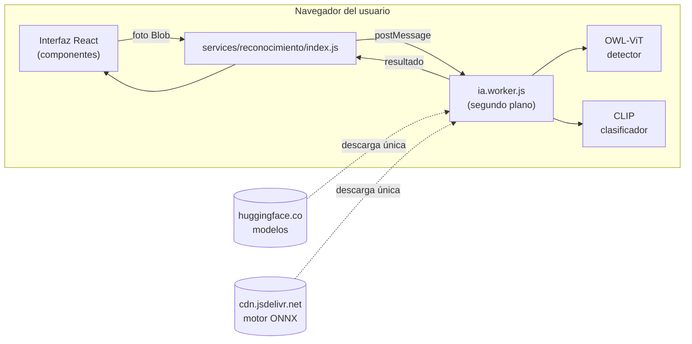
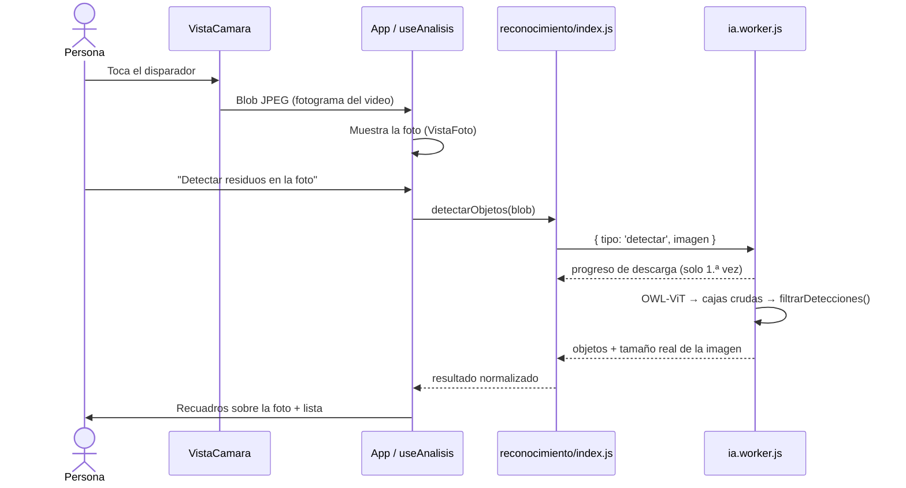

# Arquitectura y funcionamiento de la IA

Este documento explica **cómo funciona Separa Bien por dentro**: el recorrido de una foto, los modelos de inteligencia artificial que usamos, por qué los elegimos y cómo modificar su comportamiento.

- [1. Visión general](#1-visión-general)
- [2. Recorrido de una foto](#2-recorrido-de-una-foto)
- [3. La cámara](#3-la-cámara)
- [4. Los modelos de IA](#4-los-modelos-de-ia)
- [5. Detección de varios objetos (OWL-ViT)](#5-detección-de-varios-objetos-owl-vit)
- [6. Clasificación de material (CLIP)](#6-clasificación-de-material-clip)
- [7. Ejecución en segundo plano (Web Worker)](#7-ejecución-en-segundo-plano-web-worker)
- [8. Contratos de datos](#8-contratos-de-datos)
- [9. Cómo modificar categorías, consultas y umbrales](#9-cómo-modificar-categorías-consultas-y-umbrales)
- [10. Decisiones técnicas importantes](#10-decisiones-técnicas-importantes)

---

## 1. Visión general

Es una **aplicación web 100 % del lado del cliente**: no hay servidor propio ni base de datos. Todo (cámara, IA, resultados) ocurre en el navegador del celular o computador.



**Principio de diseño:** la interfaz **solo** habla con `services/reconocimiento/index.js`. Cuando tengamos un modelo propio (Fase 5), se reemplaza lo que hay detrás de ese archivo sin tocar las pantallas.

---

## 2. Recorrido de una foto



1. **Captura:** `utils/imagen.js → capturarFotograma()` copia el fotograma actual del `<video>` a un `<canvas>` y lo convierte en JPEG (calidad 0,9), sin efecto espejo. Alternativa: imagen de la galería (`BotonGaleria`), validada en tipo y tamaño (máx. 15 MB).
2. **Análisis:** el hook `useAnalisis` llama a la función de IA, muestra el progreso y **descarta respuestas viejas** si la persona tomó otra foto mientras tanto.
3. **Resultado:** `ImagenConRecuadros` dibuja las cajas; `PanelDeteccion` lista los objetos.

---

## 3. La cámara

Archivo: `src/hooks/useCamera.js` — **probado en computador y celular**.

Cada celular expone sus cámaras de forma distinta, así que se usa una **estrategia por etapas** para abrir la cámara trasera:

1. `facingMode: { exact: 'environment' }` (exigir la trasera).
2. Si falla, buscar con `enumerateDevices()` una cámara cuyo **nombre** indique "back / trasera / rear…" y abrirla por `deviceId`.
3. Último recurso: `facingMode: ideal` y luego cualquier cámara (para computadores con una sola webcam).

Después de abrir, se **verifica la cámara obtenida realmente** (`getSettings()`). Al cambiar de cámara se detienen todas las pistas anteriores y se espera 300 ms (algunos Android tardan en liberar la cámara). Si el dispositivo tiene una sola cámara, el botón se reemplaza por un mensaje. Nunca se asumen identificadores fijos.

En la vista de cámara hay un desplegable **"Información técnica de la cámara"** útil para diagnosticar en cada celular.

---

## 4. Los modelos de IA

| | **OWL-ViT B/32** | **CLIP ViT-B/32** |
|---|---|---|
| Para qué | **Localizar** varios objetos (cajas) | **Identificar el material** |
| Tipo | Detección *zero-shot* (vocabulario abierto) | Clasificación *zero-shot* |
| Cómo se le indica qué buscar | Frases de texto (`consultas-deteccion.js`) | Frases de texto (`categorias.js`) |
| Autor / licencia | Google · Apache 2.0 | OpenAI · MIT |
| Archivo usado | `Xenova/owlvit-base-patch32`, `q8` (~155 MB) | `Xenova/clip-vit-base-patch32`, solo visión `q8` (~89 MB) |
| Tiempo medido (PC, Node) | ~1,9–2,3 s por foto | ~0,15 s por foto |
| Tiempo medido (Chrome sin GPU) | ~6,1 s por foto | ~0,5 s por foto |
| Tiempo en celular | **Sin medir todavía** | **Sin medir todavía** |

*"Zero-shot"* significa que **no hubo que entrenar nada**: el modelo compara la imagen con descripciones escritas. Por eso podemos usar nuestras propias categorías desde ya, con la contrapartida de que **no está especializado en residuos**.

### ¿Por qué no YOLO, DETR u otro detector?

| Detector | Problema para este proyecto |
|---|---|
| YOLO (Ultralytics), D-FINE, RT-DETR, DETR, YOLOS | Solo conocen las **80 clases fijas de COCO** (*bottle, cup, banana…*). No conocen papel, cartón, latas, bolsas ni cáscaras. YOLO de Ultralytics además es licencia AGPL. |
| Grounding DINO | Vocabulario abierto y más preciso, pero más pesado (~204 MB) y lento para celular. Alternativa a evaluar si OWL-ViT no basta. |
| APIs comerciales (Google Vision…) | De pago y envían las fotos a terceros. Descartadas. |

---

## 5. Detección de varios objetos (OWL-ViT)

Archivos: `ia.worker.js` (tarea `detectar`), `consultas-deteccion.js`, `detectar.js`, `config.js`.

1. OWL-ViT recibe la foto y **22 consultas** de objetos frecuentes en residuos (`a bottle`, `a can`, `a sheet of paper`, `a banana peel`…). Devuelve cajas con una **puntuación**.
2. Se descartan cajas con puntuación menor a `UMBRAL_DETECCION` (0,1).
3. `filtrarDetecciones()` limpia el resultado:
   - **Ajusta** cada caja a los bordes de la imagen.
   - **Descarta cajas diminutas** (< 0,2 % del área).
   - **Descarta cajas "de fondo"** (> 85 % de la foto) **si hay otros objetos**. Si es la única caja, se conserva con la marca `posibleFondo: true` y la interfaz advierte *"podría ser el fondo"*.
   - **Elimina duplicados** (supresión de no-máximos, NMS): si dos cajas se solapan más de `IOU_DUPLICADOS` (0,5), se conserva la de mayor puntuación, **sin importar la consulta** que las encontró → un objeto = una caja. Dos botellas separadas siguen siendo dos objetos.
   - Limita a `MAX_OBJETOS` (20).
   - **Numera** los objetos en orden de lectura (franjas de arriba abajo, luego de izquierda a derecha).
4. Las cajas se devuelven en **píxeles de la imagen original**, junto con su ancho y alto.

**Importante:**
- La **puntuación del detector no es una probabilidad**; suele estar entre 0,1 y 0,6. No debe mostrarse como "% de certeza".
- La consulta que encontró el objeto (p. ej. "botella") **no** es su material: eso lo decidirá CLIP en la Etapa 2.

### Recuadros que coinciden con la foto

`ImagenConRecuadros.jsx` lee la proporción real de la imagen (`naturalWidth / naturalHeight`) y hace que el contenedor tenga **exactamente esa proporción** (CSS `aspect-ratio`). Así no hay franjas vacías y las cajas, expresadas en **porcentajes**, quedan en su sitio aunque la foto cambie de tamaño o se gire el celular. Cada recuadro es un botón: al tocarlo se resalta y los demás se atenúan.

---

## 6. Clasificación de material (CLIP)

Archivos: `ia.worker.js` (tarea `clasificar`), `clasificar.js`, `categorias.js`, `scripts/generar-embeddings.mjs`.

CLIP convierte imágenes y textos en **vectores de 512 números** que viven en el mismo espacio: si una foto y una frase se parecen, sus vectores apuntan en direcciones parecidas.

1. **Una sola vez, en el computador:** `npm run generar-embeddings` calcula el vector de cada descripción de `categorias.js` y los guarda en `embeddings-texto.json`. Así **el celular no descarga el modelo de texto** (ahorra ~64 MB y tiempo).
2. **En el celular, por cada foto:** el modelo de visión produce el vector de la imagen.
3. `clasificar()`:
   - Similitud coseno entre la imagen y **cada descripción**.
   - Por categoría se toma la **mayor** similitud entre sus descripciones.
   - Se multiplica por 100 (escala de CLIP) y se aplica **softmax** → una "confianza" por categoría que suma 1.
4. Si gana `ninguno` o la confianza es menor a `UMBRAL_CONFIANZA` (0,5) → **"no reconocido"**, mostrando igualmente las 3 opciones más probables.

**Importante:** la "confianza" de CLIP es **relativa a la lista de categorías** (si una categoría no está en la lista, CLIP repartirá la confianza entre las demás). **No es una probabilidad calibrada.**

### Categorías provisionales (pendientes de validar)

| id | Nombre en la app | Grupo provisional |
|---|---|---|
| `carton` | Cartón | reciclable |
| `papel` | Papel | reciclable |
| `plastico_pet` | Plástico PET (botellas) | reciclable |
| `plastico_otro` | Otros plásticos | reciclable |
| `aluminio` | Aluminio (latas) | reciclable |
| `vidrio` | Vidrio | reciclable |
| `organico` | Restos de frutas y verduras | orgánico |
| `ninguno` | Ningún residuo reconocible | (descarte) |

El campo **"¿Aprovechable?" siempre dice "Pendiente de validación"**: no inventamos reglas de aceptación. Eso vendrá del catálogo validado (Fase 5).

---

## 7. Ejecución en segundo plano (Web Worker)

Archivo: `src/services/reconocimiento/ia.worker.js`.

- Los modelos corren en un **Web Worker** para que la pantalla no se congele.
- **Carga perezosa:** cada modelo se descarga solo la primera vez que se usa; luego queda en la caché del navegador (Cache API).
- **Cola:** las tareas se ejecutan de una en una (el motor WASM no admite sesiones simultáneas).
- **Progreso:** el worker suma el avance de todos los archivos y lo envía a la interfaz (barra de descarga).
- **Recuperación:** si falla la **carga** de un modelo, el worker pide reiniciarse (`reiniciarWorker`). Motivo: Transformers.js encadena internamente las cargas, y un fallo "contagia" a los modelos que se carguen después.
- **Motor ONNX:** se fuerza la compilación WASM **estándar** (`ort-wasm-simd-threaded`) en lugar de la "asyncify" que Transformers.js usa por defecto. Ver [decisión 10.3](#103-motor-onnx-estándar-en-vez-de-asyncify).

---

## 8. Contratos de datos

### `detectarObjetos(imagen: Blob, { onProgreso })`

```js
{
  estado: 'detectado' | 'sin_objetos' | 'error',
  mensaje: 'El detector encontró 3 objetos.',
  objetos: [
    {
      numero: 1,                                   // orden de lectura
      caja: { x: 120, y: 80, ancho: 200, alto: 340 }, // píxeles de la imagen ORIGINAL
      puntuacion: 0.31,                            // del detector, NO es probabilidad
      consulta: 'a plastic bottle',                // texto que lo encontró
      descripcion: 'botella plástica',             // lo mismo, en español
      posibleFondo: false,                         // true si ocupa casi toda la foto
    },
  ],
  ancho: 1920, alto: 1080,                         // tamaño real analizado
  descartados: { duplicados: 2, fondo: 1, pequenos: 0, exceso: 0 },
  cajasCrudas: 6,
  modelo: 'OWL-ViT B/32 (preentrenado, vocabulario abierto)',
  tiempoMs: 6128,
}
```

### `analizarImagen(imagen: Blob, { onProgreso })` — foto completa con CLIP

```js
{
  estado: 'reconocido' | 'no_reconocido' | 'error',
  mensaje: '…',
  etiqueta: 'Plástico PET (botellas)',          // solo si 'reconocido'
  categoria: 'Posible material reciclable',     // grupo provisional
  confianza: 0.72,                              // relativa a la lista de categorías
  alternativas: [{ etiqueta, confianza }, …],   // top 3
  aprovechable: null,                           // pendiente del catálogo validado
  modelo: 'CLIP ViT-B/32 (…)',
  tiempoMs: 526,
}
```

### Mensajes del worker

| Dirección | Mensaje |
|---|---|
| → worker | `{ id, tipo: 'detectar' \| 'clasificar', imagen: Blob }` |
| ← worker | `{ id, tipo: 'progreso', modelo, cargado, total, porcentaje }` |
| ← worker | `{ id, tipo: 'resultado', …datos }` |
| ← worker | `{ id, tipo: 'error', mensaje, reiniciarWorker }` |

---

## 9. Cómo modificar categorías, consultas y umbrales

### Cambiar o agregar categorías de material (CLIP)

1. Edita `src/services/reconocimiento/categorias.js` (descripciones **en inglés**, 3–5 por categoría, frases tipo `'a photo of …'`).
2. Ejecuta **`npm run generar-embeddings`** (descarga ~64 MB la primera vez en el computador).
3. Haz commit de `categorias.js` **y** de `embeddings-texto.json`.

Si olvidas el paso 2, la app mostrará: *"Las categorías cambiaron y los vectores de texto están desactualizados"*.

### Cambiar qué objetos busca el detector (OWL-ViT)

Edita `src/services/reconocimiento/consultas-deteccion.js`. No hay que regenerar nada (OWL-ViT procesa el texto en el momento). Consejo: usar **nombres de objetos** (`'a can'`, `'a banana peel'`) en vez de materiales abstractos.

### Ajustar umbrales (`config.js`)

| Constante | Valor | Efecto al subirlo | Efecto al bajarlo |
|---|---|---|---|
| `UMBRAL_DETECCION` | 0,1 | Menos falsos positivos, pero se pierden objetos | Detecta más, pero con más cajas falsas |
| `IOU_DUPLICADOS` | 0,5 | Fusiona menos (riesgo de contar doble) | Fusiona más (riesgo de unir objetos pegados) |
| `AREA_MAXIMA_FONDO` | 0,85 | Conserva cajas más grandes | Descarta más cajas grandes |
| `MAX_OBJETOS` | 20 | — | — |
| `UMBRAL_CONFIANZA` | 0,5 | Más "no reconocido", menos errores | Más respuestas, más errores |

Todos son **valores iniciales** que deben **calibrarse con fotos reales** (ver [guía de pruebas](pruebas-y-problemas.md)).

---

## 10. Decisiones técnicas importantes

### 10.1 Todo en el navegador
Privacidad (las fotos no salen del dispositivo), costo cero de servidores y funciona sin backend. Contrapartida: descarga inicial grande y depende de la potencia del celular.

### 10.2 Vectores de texto precalculados
El modelo de texto de CLIP (~64 MB) solo se usa en el computador para generar `embeddings-texto.json`. El celular descarga únicamente el modelo de visión.

### 10.3 Motor ONNX estándar en vez de "asyncify"
OWL-ViT contiene una conversión a `double` (nodo `/class_head/Cast`, tipo 11). La compilación **asyncify** de ONNX Runtime Web —la que Transformers.js elige por defecto en el navegador— **no la implementa** y fallaba con:

```
Can't create a session. ERROR_CODE: 9, ERROR_MESSAGE: Could not find an
implementation for Cast(13) node with name '/class_head/Cast'
```

Se verificó que la compilación **estándar** (`ort-wasm-simd-threaded`) carga OWL-ViT y CLIP, y además pesa menos (14 MB vs 27 MB). Se configura en `ia.worker.js` (`env.backends.onnx.wasm.wasmPaths`).

### 10.4 Detector + clasificador (y no uno solo)
OWL-ViT es bueno **localizando** objetos con vocabulario abierto; CLIP es mejor **comparando** un recorte con categorías de material. La Etapa 2 combinará ambos: recortar cada caja y clasificarla con CLIP.

### 10.5 Honestidad en los resultados
- No se muestran resultados simulados ni ejemplos como si fueran reales.
- Puntuaciones del detector y "confianza" de CLIP se presentan como lo que son (no probabilidades calibradas).
- Se indica claramente cuando algo no se reconoce o podría ser el fondo.
- "¿Aprovechable?" queda pendiente hasta tener el catálogo validado.
